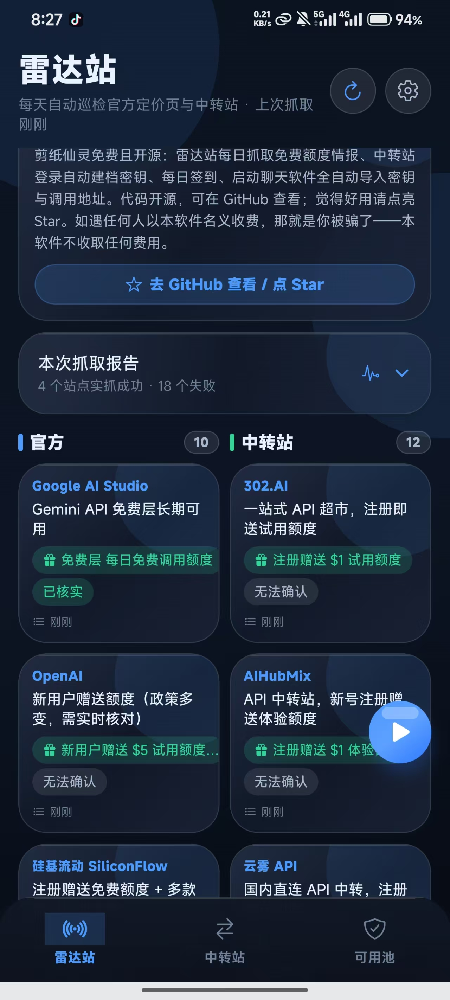
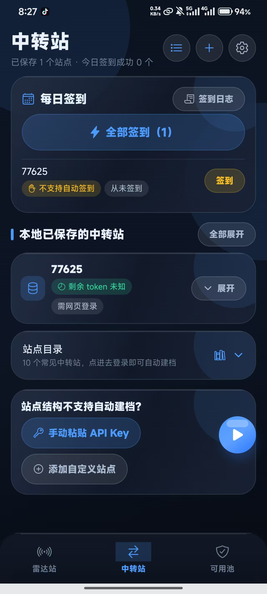
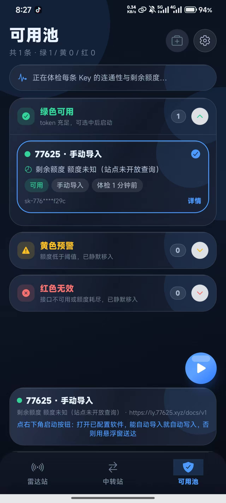

# 剪纸仙灵

**中转站上的中转站，让你高效配置自己的 API，看到哪些中转站活着、签到额度。**  
**密钥本地保存，不怕泄露。保存中转站，一键签到。**  
**抓取官方免费额度，让你白嫖得一干二净。**

免费开源 · 免注册免登录 · 打开即用 · 只有手机 App

> 仓库：https://github.com/dongjinkui72-create/jianzhi-xianling  
> 安装包：https://github.com/dongjinkui72-create/jianzhi-xianling/releases  
> 最新版 v2.0.10：https://github.com/dongjinkui72-create/jianzhi-xianling/releases/tag/v2.0.10  
>
> **本软件永久免费、代码开源。如遇任何人以本软件名义收费，那就是你被骗了。** 觉得好用请到仓库点亮 Star。

## 界面预览

| 雷达站 | 中转站 | 可用池 |
| --- | --- | --- |
|  |  |  |

---

## 一分钟上手

```bash
cd jianzhi-xianling
npm install
npx expo start          # 扫码用 Expo Go 先看看界面
```

> 适配 **Android 10（API 29）及以上**（minSdkVersion 24，向下兼容到 Android 7；目标 SDK 36）。
>⚠️ 想让「自动识别已安装的聊天软件」真正生效，必须用**开发版**而不是 Expo Go：
>
> ```bash
> npx expo prebuild --clean
> npx expo run:android   # 需要 Android SDK；iOS 用 npx expo run:ios（需 macOS）
> ```
>
> 原因见下方「能力边界」。在 Expo Go 里，App 会把扫描结果如实标成**「无法确认」**，
> 而不会谎报「未安装」。

---

## 两个核心功能（不可缺）

### ① 在中转站自动创建 API 密钥并保存到本机

「中转站」页 → 选一个站点 → 「打开并登录」→ 在 App 内置浏览器里正常登录。
登录成功后 App 会**自动**完成：

1. 通过页面内 `fetch` 桥接读取登录态（HttpOnly 的 session cookie 由 WebView 自己带上，无需用户复制任何东西）
2. 探测站点架构（`GET /api/status`）
3. 读取账号与余额（`GET /api/user/self`）
4. 创建**系统访问令牌**（`POST /api/user/access_tokens`）并存进 SecureStore —— 之后签到 / 查余额都不用再开网页
5. 创建 API Key（`POST /api/token/`）→ 列表定位（`GET /api/token/?p=1&page_size=100`）→ 取回完整密钥（`POST /api/token/:id/key`）
6. 密钥写入 SecureStore，调用地址 + **掩码**写入 SQLite

适配 New API / One API 架构（国内绝大多数中转站都是这套开源面板）。
接口路径与响应结构均已对照上游源码核对，见 `src/services/relayApi.ts` 顶部注释。

**做不到时如实说**：站点面板不是这套架构、或只返回掩码且不开放完整 Key 查询时，
UI 会明确告诉你「这个站点没法自动建档」，并给出手动粘贴入口，绝不假装成功。

### ② 点启动按钮 → 拉起聊天软件 → 全自动导入，零复制粘贴

「能不能自动导入」被做成了**数据驱动的适配器注册表**（`src/data/chatAppRegistry.ts` + `src/lib/importUrls.ts`），
每种软件一条适配器，按 `importKind` 分四类，全部如实回报：

| importKind | 含义 | 当前覆盖 |
| --- | --- | --- |
| `deeplink_import` | 目标 App 官方 deep link 直写提供方配置 | **Chatbox**（v1.15.1+，`chatbox://app/import-config?type=&data=`） |
| `url_settings_import` | 通过 URL 参数把 keyVaults 写进目标 App | **LobeChat**（官方「URL 分享配置」：`{base}/?settings={"keyVaults":{...}}`，网页版 / PWA / 桌面版） |
| `launch_only` | 只能拉起，无法写入密钥，UI 明说 | DeepChat（官方 DeepLinks 只到「开始聊天 / 装 MCP」）、ChatGPT / Claude / Gemini / DeepSeek / Kimi / 豆包 / 通义 / 元宝 / Grok / Poe |
| `unconfirmed` | 协议未核实，**绝不贸然发送** | Cherry Studio（已发现 `cherrystudio://providers/api-keys` 入口但参数结构未核实）、NextChat、ChatWise、OpenCat |

密钥明文只从本机 SecureStore 读出后直接拼进链接交给目标 App，**全程不经过剪贴板**。

#### 长尾软件（含 GitHub 开源项目）不用发新版就能支持

仓库自带 `adapters/clients.json`。App 启动时会自动拉取并合并公开清单，
新增/修正某个软件的导入协议**不需要更新 App**。清单是公开 JSON，不含任何私有数据。

```json
{
  "adapters": [
    {
      "id": "chatbox",
      "name": "Chatbox",
      "scheme": "chatbox",
      "importKind": "deeplink_import",
      "importTemplate": "chatbox://app/import-config?type={type}&data={data}",
      "platform": "all",
      "note": "诚实说明"
    }
  ]
}
```

不变量（`npm run verify` 里有断言守着）：标 `unconfirmed` 的适配器**不允许**带导入模板，
从代码层面杜绝「没核实就发送」。
---

## 底部导航 + 悬浮启动按钮

底部导航三等分：**雷达站 / 中转站 / 可用池**，各占三分之一，比常规更高。

启动按钮是一个**小型悬浮按钮**，浮在界面右下角、底部导航之上：
- 没有在设置里配置聊天软件、或没有选中绿色可用 API 时，按钮保持灰色不可点；
- 配置好软件并选中 API 后亮起，点击**只会打开你在设置里选定的那个 App**；
- 打开后自动检测该软件能否写入密钥：能自动导入就直接写入；不能自动导入就先打开 App，再用系统悬浮窗把调用地址和密钥送到它界面上，由你点一下复制。

### 雷达站

「官方」和「中转站」是**平行的两个分组，表头同一行、内容左右两栏并列**。
每天自动抓取厂商定价页与中转站首页（关键词 `api`），点卡片看完整「怎么领」步骤。
内置种子库离线兜底，保证中转站分区 ≥ 5 条（实际内置 12 条）。

### 中转站

顶部「一键签到」会在后台自动完成，不跳转网站：优先走站点签到接口；接口不存在时自动定位你登录时所在的控制台页面，找到「签到 / 已签到」按钮并点击，确认成功后才记录。
支持一次签到多个已保存站点，结果只写本机日志；站点明确关闭签到时如实标注「不支持」，不会伪造成功。

下面是本地已保存的站点（名称 + 链接 + 剩余 token），默认折叠，每行都有展开按钮。

### 可用池

- 打开即自动体检；**每条 API 都显示剩余额度**（tokens + 美元）；
- **绿色可用 / 黄色预警 / 红色无效** 三个分组，默认全部折叠，各自带展开按钮；
- 只有绿色分组可选中；预警与无效只静默归组，App 永远不会提示「建议删除该 API」；
- 「未选择 API + 启动提示」这一块居中放在底部「可用池」那一行的上面。

### 启动过场

原生启动图 → 水晶玻璃过场动画（logo 缩放 + 渐显 + 淡出）→ 主界面。
数据库初始化等加载过程全部被盖住，用户看不到任何 loading 文案。
---

## 数据分层（产品红线）

| 层 | 位置 | 内容 |
| --- | --- | --- |
| 公开情报 | 云端（匿名可读） | `providers` / `benefits` / `relays` / `clients` |
| 私有数据 | 本机 SQLite | 站点档案、API **掩码**、签到日志、自建软件、设置 |
| 敏感数据 | 本机加密区 SecureStore | 真实 API Key、系统访问令牌 |

数据库里的 Key 一律是 `sk-abc****wxyz` 这种掩码。**App 不向任何服务器上传你的密钥或签到记录。**

---

## 抓取数据的边界归一化与噪声排除

外部页面很容易把「262,144 tokens 上下文窗口」误判成赠送额度。
`src/lib/normalize.ts` 用三道防线拦住：

1. **文本归一化**：全角转半角、NFKC、压缩空白、去零宽字符
2. **噪声排除**：数字邻域若出现「上下文 / context window / 最大输出 / 速率限制」等词，
   且噪声词比福利词更靠近数字，直接丢弃
3. **边界归一化**：数字必须紧邻明确的额度单位（tokens / $ / ¥ / 次 / 天），
   中文数量级（万、亿）与英文数量级（K/M/B）统一折算；块级 HTML 标签转换行以正确断句

跑一遍验证：

```bash
npm run verify
```

覆盖 27 项断言，包含「混排句里必须取 `$5` 而不是 `262,144 tokens`」这类回归用例。

---

## 能力边界（做不到就如实标注）

| 能力 | 状态 | 说明 |
| --- | --- | --- |
| 自动建档 API Key | ✅ New API / One API | 其它架构标「不支持」+ 手动入口 |
| 一键签到 | ⚠️ 视站点 | 未开启签到 / 强制 Turnstile 人机验证的站点标「只能手动」，日志记 `manual_only`，**绝不伪造成功** |
| 全自动导入聊天软件 | ✅ Chatbox | 其它软件标「仅能打开」或「无法确认」 |
| 扫描已安装软件 | ⚠️ 需开发版 | Android 11+ 包可见性 / iOS `LSApplicationQueriesSchemes` 都要原生壳预声明白名单，见 `plugins/withChatAppQueries.js`。Expo Go 里无法扩展 → 一律标「无法确认」 |
| 余额查询 | ⚠️ 视站点 | 站点没开放 `dashboard/billing` 时标「仅确认连通」 |
| 网络不可达 | — | 标「无法确认」，**不会**谎报「已失效」 |

---

## 界面

- **iPhone 水晶玻璃主题**，配色固定为**水晶白且不可更改**（`src/theme/tokens.ts` 里是常量，App 内没有换肤入口）
- 大屏小屏自适应：以 390pt 逻辑宽度为基准等比缩放，夹在 `[0.86, 1.30]`，
  字号再乘系统字体缩放（同样限幅），小屏不挤爆、大屏不空荡（`src/theme/useScale.ts`）

---

## 目录结构

```
App.tsx                       启动 + 数据库就绪闸门
plugins/withChatAppQueries.js 原生壳白名单（Android <queries> / iOS LSApplicationQueriesSchemes）
scripts/verify-core.js        核心逻辑验证（27 项）
src/
  theme/                      水晶玻璃主题、大小屏缩放
  components/                 Glass / Header / Bits（Chip、Sheet、Notice…）
  navigation/                 RootNavigator + CrystalTabBar（含圆形启动按钮）
  launch/LaunchProvider.tsx   启动流程编排：选软件 → deep link 全自动导入 → 如实回报
  screens/
    RadarScreen.tsx           雷达站（官方 / 中转站）
    RelayScreen.tsx           中转站（签到 + 本地站点折叠列表 + 手动入口）
    RelayWebScreen.tsx        内嵌浏览器登录 + 自动建档
    PoolScreen.tsx            可用池（体检 / 预警区 / 底部启动坞）
    SettingsScreen.tsx        设置（右上角进入）
  services/
    relayApi.ts               New API / One API 接口层
    relayBridge.ts            WebView 页面内 fetch 桥接（带 HttpOnly Cookie）
    healthCheck.ts            可用池体检
    detectApps.ts             已安装聊天软件识别（含「无法确认」判定）
    launcher.ts               deep link 构造与启动
    radarFeed.ts              情报抓取（远程 JSON → 实抓官网 → 内置种子，逐层降级）
  data/
    db.ts                     SQLite（本机私有数据）
    vault.ts                  SecureStore（真实密钥）
    seed.ts                   内置情报种子库 + 站点目录
    chatAppRegistry.ts        聊天软件登记表
  lib/                        normalize / format / base64 / types / id
```

---

## 免责

内置站点目录仅为公开信息整理，**本 App 不代收任何费用、不经手你的充值**。
第三方中转站的可信度请自行甄别。额度情报来自公开页面抓取，厂商政策随时会变，实际以官网为准。

## License

MIT

---

## 本机 Windows 出包配方（已验证可产出 APK）

Windows 上打 RN 的 release 包有三个坑，本仓库都给了开关/脚本：

1. **JDK 17 + Android SDK/NDK**：本机构建链放在 `D:\android-toolchain`（JDK 17.0.2、platform-36、build-tools 36.0.0、NDK 27.1.12297006、CMake 3.30.5），Gradle 缓存复用 `D:\gradle-home`，镜像走阿里云/腾讯。
2. **ninja 的 260 字符路径上限**：RN codegen 的对象目录在中文/长路径下必超。两步绕开：
   - `scripts/fix-win-longpaths.ps1 -ProjectDir <构建副本>`：把各原生库 codegen 生成目录挂成 `D:\cg\<x>` 短联接并改写其 `jni/CMakeLists.txt`；
   - 构建时设 `JZ_SHORT_BUILDDIR=1`，`android/build.gradle` 会把各模块 buildDir 重定向到 `D:/b/android-<hash>`（映射见 `D:/b/_mapping.txt`）。其它环境不设该变量则完全不受影响。
3. **中文路径**：Gradle/CMake/AGP 在中文目录下会转码出错。构建副本请放在纯英文路径（本机为 `D:\p`），并把 `TEMP/TMP` 与 `java.io.tmpdir` 指到英文目录。

其它构建决策：
- `newArchEnabled=false`：新架构下 RN 核心 codegen 的对象路径在 Windows 上必然超限；旧架构在 RN 0.88 仍受支持，功能不受影响。
- 移除了 `react-native-gesture-handler`：底部导航并不依赖它，而它的 codegen 源目录是路径超限的最大来源。
- 测试包关闭了 R8 混淆（`android.enableMinifyInReleaseBuilds=false`），正式分发时可在非 Windows 环境开启。

出包命令（构建副本内）：

```bash
gradlew.bat assembleRelease      # 产物 android/app/build/outputs/apk/release/app-release.apk
```

APK 签名当前使用 debug keystore（便于直接安装测试）；正式分发请自建 keystore 并配置 `signingConfigs.release`。

## 系统支持范围

- **Android 10（API 29）及以上**为设计目标；`minSdkVersion 24`，实际向下兼容到 Android 7。
- 产物架构：`arm64-v8a`（当前测试包）。需要 32 位老设备时在 `gradle.properties` 里把 `reactNativeArchitectures` 加回 `armeabi-v7a` 重新出包。
- iOS 需 macOS + Xcode 出包，代码与主题已按 iOS 水晶玻璃规范写好。

---

## 2.0 变更

1. **升级继承数据**：包名与签名不变，SQLite 文件（中转站、API 掩码、签到日志、适配器、设置）与 SecureStore（真实密钥、访问令牌）都留在应用数据目录里，覆盖安装即继承。schema 变更只做「加列 / 建表」式迁移（`meta.schema_version`），不删改用户数据。
2. **极简 UI**：除提示框外，所有灰色解释性文案已删除。
3. **中转站抓取关键词**：`api` + `中转站`。
4. **中转站登录页只留两个按钮**：「手动粘贴密钥」「我已登录，自动创建保存密钥和调用地址」；不展示任何执行日志。面板架构识别覆盖 New API / One API / Veloera / Done-hub 同构系，识别不到就如实说明。
5. **每日签到**：登录时自动探测该站有无免费签到；有则自动加入「每日签到」列表，可一键签到；没有则只建档，过程与第 4 条相同。
6. **可导入软件识别**：登记表新增 SillyTavern（tavern）、TauriTavern（tauritavern）、ChatterUI 等接受自定义端点的开源客户端；AI 恋爱类官方 App 与大厂官方 App 一样不接受第三方密钥，不在可导入列表。
7. **手动添加 = 搜索框**：输入名称/包名即时搜索已安装应用与登记表，点结果由 App 自动识别导入方式。
8. **悬浮窗凭证层兜底**：对没有自动导入协议的软件，启动后以系统悬浮窗把调用地址与密钥盖在目标 App 上；默认收起（小圆钮），点一下展开显示并可复制，再点收起，长按关闭。需一次性授权「显示在其他应用上层」。
9. **主界面通告**：说明功能与开源地址、请到 GitHub 点 Star、并声明本软件永久免费、遇收费即被骗。

---

## 出包前检查约定（用户指定）

改动后**只跑一遍**以下易错项即可，不需要重复多遍：

```bash
npm run verify     # 类型无关的逻辑红线：39 条断言 + 升级迁移仿真 + INSERT 列数/占位符静态检查
npm run typecheck  # TypeScript 0 错误
npx expo export --platform android --output-dir .export-test --no-minify   # Metro 打包冒烟
```

这三条覆盖历史上真正出过事故的点：
- `relays` INSERT 列清单漏列导致启动崩溃 → INSERT 静态检查；
- 旧库升级 schema 漂移 → 迁移仿真 + 启动时 PRAGMA 强校验；
- 额度误判（上下文窗口当赠送额度）→ 归一化断言；
- 导入协议谎报 → 适配器诚实性断言。

